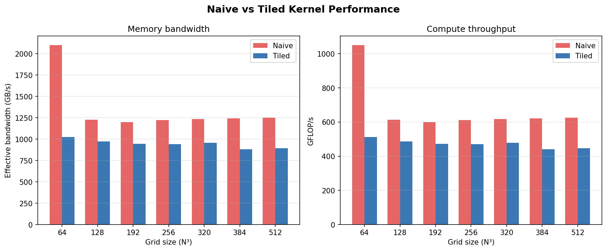

# Performance Benchmarks

**GPU:** NVIDIA GeForce RTX 4050 Laptop GPU  
**CUDA:** 12.8  
**Stencil radius:** 4  

## Kernel comparison (naive vs tiled)

| Grid | Naive BW (GB/s) | Tiled BW (GB/s) | Speedup |
|------|----------------|----------------|---------|
| 64³ | 2100.4 | 1024.2 | **0.49×** |
| 128³ | 1226.9 | 971.5 | **0.79×** |
| 192³ | 1198.8 | 943.6 | **0.79×** |
| 256³ | 1221.3 | 942.3 | **0.77×** |
| 320³ | 1234.4 | 958.2 | **0.78×** |
| 384³ | 1241.2 | 882.9 | **0.71×** |
| 512³ | 1249.9 | 893.8 | **0.72×** |

**Average speedup: 0.72×**

## Plots

